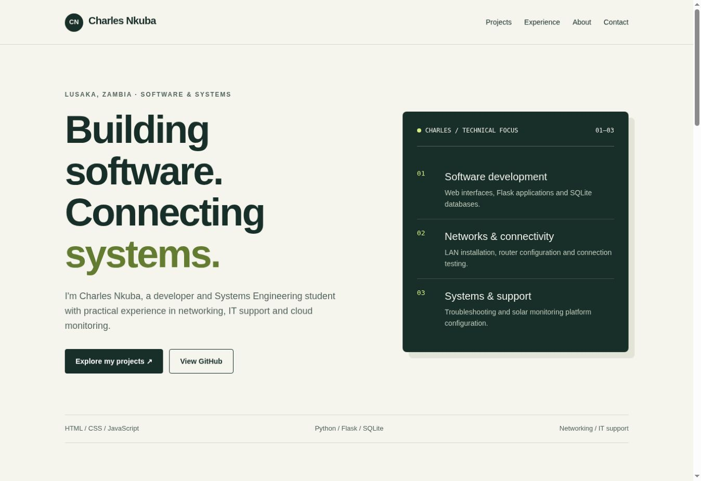

# Charles Nkuba — developer portfolio

A responsive portfolio introducing my software development prototypes, Systems Engineering studies and practical networking/IT experience.

[Open portfolio](https://charlesnkuba.github.io/) · [Try the Inter-Ministry Data Exchange demo](https://charlesnkuba.github.io/projects/inter-ministry/) · [LinkedIn](https://www.linkedin.com/in/nkubacharles8)



## Projects and status

| Project | Status | What it demonstrates |
| --- | --- | --- |
| Inter-Ministry Data Exchange | Working front-end prototype | Dataset search, sample access requests, simulated review roles, audit events and CSV exports |
| Carbon footprint tracking system | Live project overview; Flask source not published | Planned Flask/SQLite activity tracking, predefined emission calculations, dashboards and rule-based recommendations |
| HTML learning portfolio | Introductory prototype | HTML document structure, images, links and multi-page navigation |
| HTML résumé website | Introductory prototype | Semantic résumé content and a small multi-page website |

All projects on my GitHub are prototypes. The exchange demo uses fictional data and browser-local state. Its roles are simulated; it is not a deployed government service.

## Reviewer shortcuts

- [Exchange source, screenshots and walkthrough](projects/inter-ministry/README.md)
- [Exchange automated workflow checks](projects/inter-ministry/tests/workflow.cjs)
- [HTML portfolio source](https://github.com/charlesnkuba/html-Portfolio)
- [Live developer résumé](https://charlesnkuba.github.io/My-Resume/) · [Résumé source](https://github.com/charlesnkuba/My-Resume)
- [Live HTML learning portfolio](https://charlesnkuba.github.io/html-Portfolio/)
- [Live carbon project overview](https://charlesnkuba.github.io/projects/carbon-footprint/)

## Run locally

```sh
python3 -m http.server 8000
```

Open `http://localhost:8000/` for the portfolio or `http://localhost:8000/projects/inter-ministry/` for the exchange prototype. There is no dependency installation or build step.

## Structure

- `index.html`: portfolio content and responsive styles
- `projects/inter-ministry/`: complete exchange prototype, documentation and tests
- `assets/screenshots/`: screenshots captured from the published websites
- `.nojekyll`: static GitHub Pages serving

## Design choices

System fonts and buildless HTML keep deployment simple. Projects carry explicit prototype labels and development status. Semantic landmarks, a skip link, keyboard focus styles and responsive CSS help visitors navigate.

## Validation

Portfolio internal links were checked. Exchange workflow tests cover request transitions, simulated permissions, duplicate prevention, escaping, CSV formatting and storage. Screenshots document the published desktop views; they are not proof of comprehensive cross-browser or mobile testing.

The carbon footprint project's source, screenshots and tests will be added when its actual code is available.

## Development updates

Updates committed to `main` are published by the configured GitHub Pages deployment. Live addresses stay stable. Changes made only on a personal computer do not synchronize automatically: commit/push them or share the changed files for a repository update. The Flask application needs a Python backend host when its actual source is supplied.
