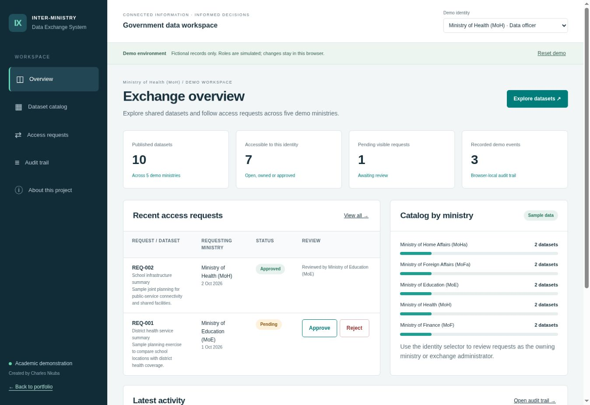
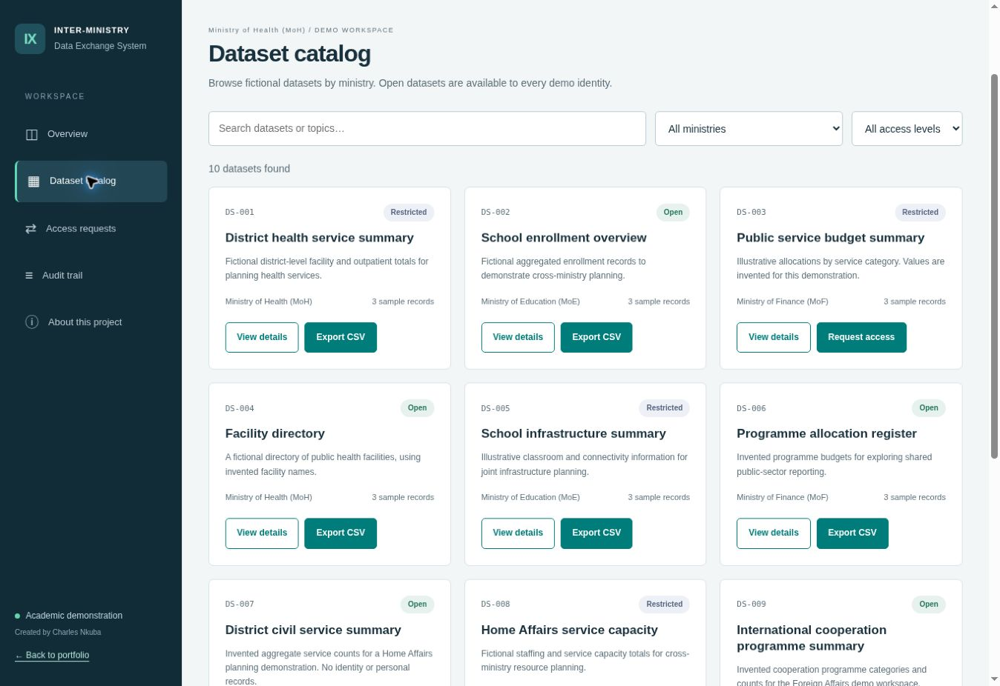
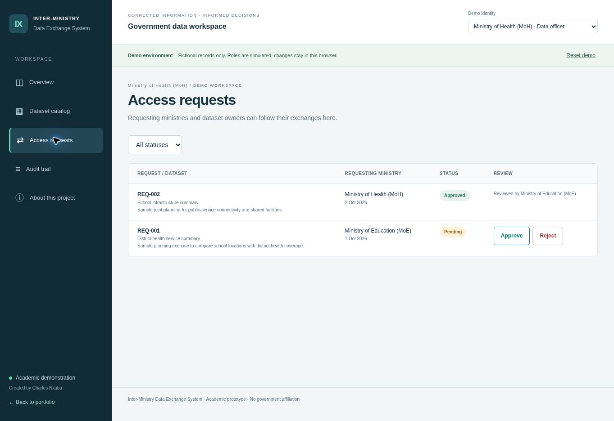

# Inter-Ministry Data Exchange System

An academic prototype by Charles Nkuba for discovering datasets and managing access requests between ministries.

[Try the live demo](https://charlesnkuba.github.io/projects/inter-ministry/) · [Portfolio](https://charlesnkuba.github.io/) · [Public demo source](https://github.com/charlesnkuba/charlesnkuba.github.io/tree/main/projects/inter-ministry)



## Problem and workflow

Teams need a clear way to identify who owns a dataset, explain why they need it and follow the request's outcome. This prototype demonstrates that workflow with fictional records.

1. A ministry officer discovers a dataset.
2. Open and owned datasets can be previewed immediately. Other restricted datasets require a simulated access request.
3. The officer submits a purpose of 10–500 characters.
4. The owning ministry or exchange administrator approves or rejects the pending request.
5. Approved access enables sample previews and CSV export for the requesting ministry.
6. Request, review and export actions are recorded in a browser-local demo audit trail.

## Ministries

| Ministry | Abbreviation | Demo identity |
| --- | --- | --- |
| Ministry of Home Affairs | MoHa | Data officer |
| Ministry of Foreign Affairs | MoFa | Data officer |
| Ministry of Education | MoE | Data officer |
| Ministry of Health | MoH | Data officer |
| Ministry of Finance | MoF | Data officer |

An exchange administrator identity can review requests across the five ministries. There are ten fictional datasets, with open and restricted examples for each ministry.

## Working features

- Dataset search plus ministry/access filters
- Identity-dependent record previews and CSV export
- Pending, approved and rejected request states
- Duplicate pending-request prevention
- Owner and administrator review rules
- Request-purpose validation and escaped user text
- CSV quote escaping and formula-like text protection
- Browser-local persistence, demo reset and unavailable-storage fallback
- Audit trail display and CSV export
- Responsive layouts, labelled controls and visible keyboard focus

## Screenshots

### Dataset catalog



### Request review



Screenshots are captured from the published desktop demo using fictional sample records.

## Try a complete exchange

1. Select **Ministry of Health (MoH)**.
2. Open the catalog and request **Public service budget summary** from Finance.
3. Enter a purpose of at least ten characters and submit.
4. Switch to **Ministry of Finance (MoF)** or **Exchange administrator** and approve the request.
5. Switch back to Health, preview the dataset and export its sample CSV.
6. Inspect the audit trail and reload to check persistence in the same browser.

## Run locally

```sh
python3 -m http.server 8000
```

Open `http://localhost:8000/`. Keep `index.html`, `styles.css` and `app.js` together. No packages, database or build step are required.

## Run checks

With Node.js installed:

```sh
node --check app.js
node tests/workflow.cjs
```

The dependency-free checks exercise access predicates, request submission, duplicate prevention, unauthorized review, approvals, terminal states, administrator rejection, HTML escaping, CSV escaping, persistence and five-ministry ownership rules. They use a small DOM/storage harness, so they do not replace browser integration tests.

## Implementation decisions

| Decision | Reason and limitation |
| --- | --- |
| Plain HTML/CSS/JavaScript | Easy to inspect and deploy to GitHub Pages; no backend runtime |
| Fixed fictional datasets | Demonstrates the workflow without exposing personal or government data |
| Explicit request state transitions | Only pending requests can be reviewed; duplicate pending requests are blocked |
| Browser storage | Reload persistence without a server; editable locally and not shared between devices |
| Simulated identities | Lets reviewers explore requester and owner perspectives; does not authenticate users |

## Security boundary

This is a **front-end prototype**, not an operational government service. All records are fictional, and the project has no government affiliation. Every dataset is present in client-side source. “Restricted” is a workflow label, not a confidentiality guarantee.

The role selector is not a login. Visitors can edit localStorage and the audit trail. Browser-local state does not synchronize across users or devices. The private project repository is retained, while the demo source is also published in the public portfolio repository for inspection.

A production version would require a backend, authenticated identities, server-side authorization and validation, protected database storage, tamper-resistant audit controls and reviewed operational policies. GitHub Pages alone cannot provide these controls.

## Next implementation work

- Backend API and authenticated sessions
- Database-backed requests and server-side permission enforcement
- Data owner management and controlled dataset publishing
- Protected audit storage and backend/integration tests

These are planned improvements, not implemented features.
